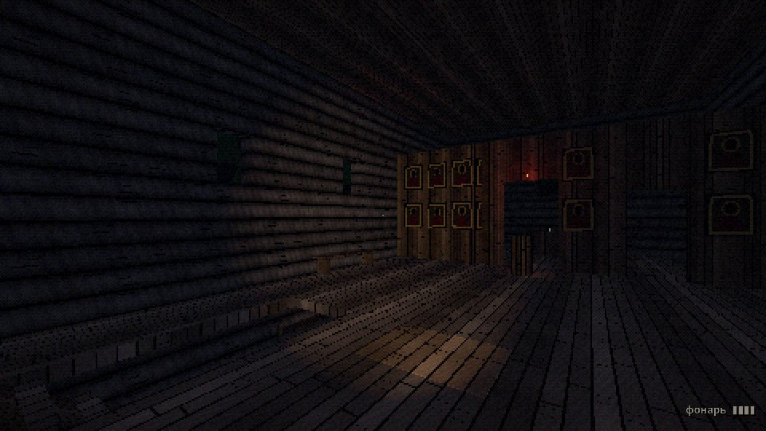
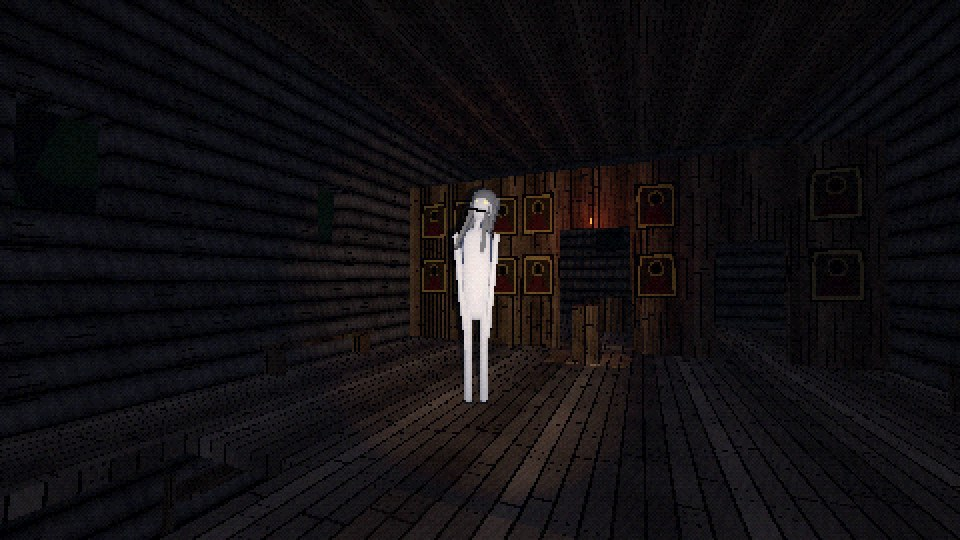
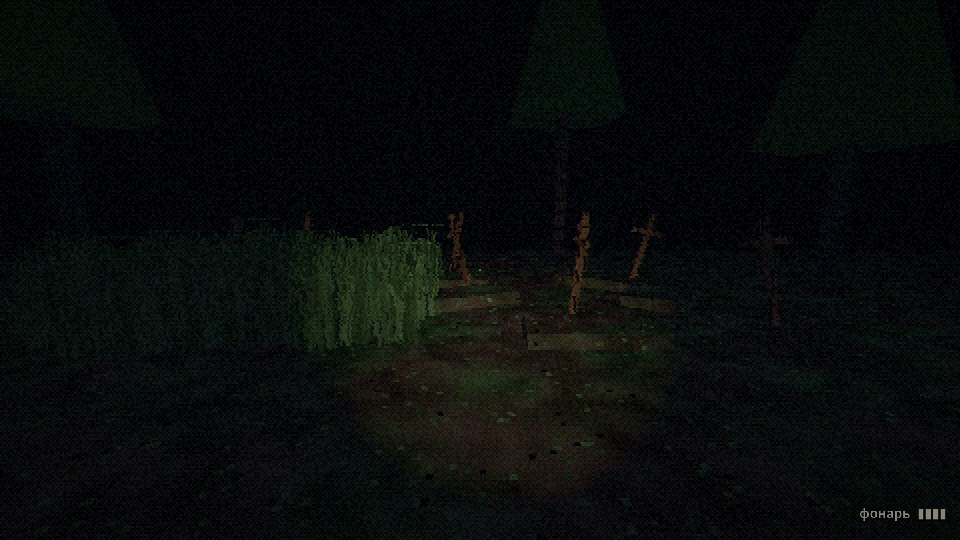
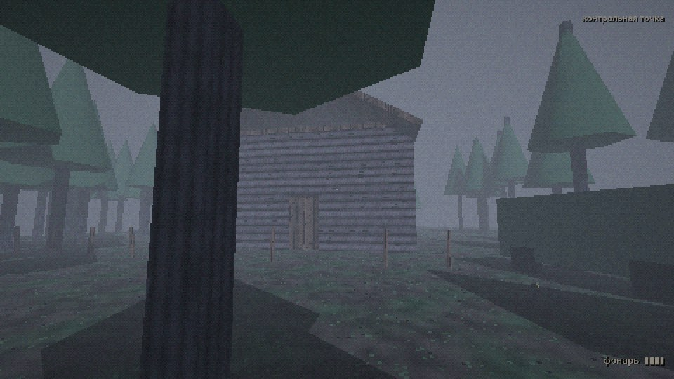

# Сторож: вертикальный срез

Сюжетный хоррор от первого лица на Godot 4. Это **этап 1 из диздока**: ночь в церкви со Сторожем.
Задача среза — проверить, страшно ли играть. Если страшно, вокруг него строим остальную игру,
если нет — сначала чиним атмосферу, а контент делаем потом.




<details><summary>Ещё кадры: погост и рассвет</summary>




</details>

## Как открыть

1. Скачай **Godot 4.7.2** (обычную версию, не .NET): https://godotengine.org/download/archive/4.7.2-stable/
2. Запусти Godot → **Импорт** → выбери файл `storozh/project.godot`.
3. При первом открытии Godot пару минут импортирует текстуры и звуки. Это нормально.
4. **F5** запускает игру с главного меню. **F6** запускает открытую сцену: удобно, когда открыт `scenes/game.tscn`.

Если в окне «Вывод» (Output) появились красные ошибки, скопируй их целиком и пришли мне.
Пришли ещё скрин того, что видно в игре.

## Управление

| Клавиша | Действие |
|---|---|
| WASD | ходьба (работает и на русской раскладке) |
| Shift | бег (выносливость ~6 секунд, потом одышка, а её Сторож тоже слышит) |
| Ctrl / C | присесть: почти бесшумно, и видно тебя хуже |
| E | действие: подобрать, открыть дверь, спрятаться, вылезти |
| F | фонарик (батарейка садится, свет видно издалека) |
| ПКМ | поднять камеру Кости (видоискатель) |
| ЛКМ | вспышка: ослепляет Сторожа на 2,5 с, зарядов мало |
| Пробел в укрытии | задержать дыхание (до 7 секунд) |
| Esc | пауза и настройки |
| **F3** | отладка: состояние Сторожа, час ночи, уровень страха |
| **F5** | отладка: промотать час ночи |

Геймпад тоже настроен: стики, A — действие, Y — фонарик, X — дыхание, курки — камера и вспышка.
F3 и F5 работают только при запуске из редактора (в отладочной сборке).

## Что есть в срезе

Сверено с чек-листом «Этап 1» из диздока:

- [x] Проект и репозиторий
- [x] Игрок: ходьба, бег, присед, шаги (свой звук на досках и на земле), фонарик
- [x] PS1-шейдер и туман: дрожание вершин, текстуры без сглаживания, 480×270, дизеринг, 15-битный цвет
- [x] Серый блокаут церкви с подполом, иконостасом, алтарём и двором с погостом
- [x] Сторож: брожение, слух, зрение, погоня, поимка (+ ослепление и поиск по схеме)
- [x] Укрытия (лавки, шкафы, высокая трава) и задержка дыхания
- [x] Эффекты страха: шум и дёрганье картинки, сердце, дрожащий луч фонаря. Звуки Сторожа: смех, щелчки, стук по стеклу
- [x] Таймер до рассвета (часов на экране нет, время видно по небу и по птицам), экраны смерти и победы
- [ ] Дать поиграть 2–3 друзьям и записать, где страшно, а где скучно. **Это твоя часть, босс**

Сверх чек-листа уже есть: двери, скрипучие половицы, батарейки и заряды вспышки,
контрольные точки на 2-м и 4-м часу, пауза с настройками (чувствительность, пикселизация, громкость),
эхо в церкви, главное меню.

## Как устроен Сторож

Конечный автомат по схеме из диздока (`scripts/enemy/storozh.gd`):

```
Бродит --шум--> Проверяет шум --видит--> Погоня --догнал--> Поимка
                Проверяет шум --никого--> Ищет рядом
                Погоня --потерял--> Ищет рядом
                Погоня --вспышка--> Ослеплён --очнулся--> Ищет рядом
                Ищет рядом --не нашёл--> Бродит
```

Сверх схемы добавлено: если он прямо увидел игрока во время брожения или поиска, сразу начинается погоня,
а до начала ночи он «спит» в подполе (`DORMANT`). Громкий шум может его разбудить раньше.

Правила из диздока, которые реально работают в коде:

- **Шум и свет ведут его к месту, а не к игроку.** Шаги, двери, скрип и вспышка создают шум с радиусом.
  Фонарь он видит за 28 м, но с такого расстояния только идёт проверить место.
- **В укрытии найдёт, только если** видел, как ты туда залез, или услышал дыхание.
  Обычное дыхание слышно на 2,6 м. Задержишь слишком надолго — будет судорожный вдох, а его слышно на 9 м.
- **Вспышка** ослепляет, если он в конусе 35° ближе 10 м и между вами ничего нет.
- **Каждый час ночи** он слышит на 10% дальше и ходит на 0,12 м/с быстрее.
- **Игрок всегда понимает, почему его нашли.** На экране смерти написана причина
  («услышал твоё дыхание», «видел, как ты спрятался») и что его привлекло («скрип половиц»).

Чтобы давление не пропадало: если он 40 секунд бродит впустую, то тихо появляется ближе к игроку,
под окном (стучит ногтем по стеклу) или в подполе, причём только там, куда игрок сейчас не смотрит.
Двери он не открывает руками: подходит, и створка с грохотом распахивается.

## Как настраивать

Все цифры вынесены в инспектор, код трогать не нужно:

- **Сторож** (`scenes/enemy/storozh.tscn`): скорости, дальность зрения, слух, время поиска.
- **Игрок** (`scenes/player/player.tscn`): скорости, радиусы шума, батарейка, вспышка, дыхание.
- **Ночь** (`scenes/game.tscn`, узел Game): длина ночи (сейчас 7 минут), часы контрольных точек, когда просыпается Сторож.
- **Свет и туман** (корень `scenes/levels/ch4_night_church.tscn`): цвета неба, яркость, плотность тумана ночью и на рассвете.
- **PS1-вид**: материал на узле `World` в `game.tscn` (уровни цвета, шум, виньетка) и `jitter_grid` в материалах (сила дрожания).

## Структура

```
storozh/
  project.godot
  scenes/
    main_menu.tscn, game.tscn       меню и «одна ночь» (уровень внутри пиксельного SubViewport + HUD)
    player/player.tscn              игрок: камера, фонарик, луч взаимодействия
    enemy/storozh.tscn              Сторож (модель из примитивов) и его ИИ
    levels/ch4_night_church.tscn    блокаут церкви
    props/                          лавка и шкаф (укрытия), дверь, батарейка, скрипучие доски, трава, свеча
  scripts/
    autoload/game_state.gd          настройки, флаги сюжета, контрольная точка, сохранение в user://save.json
    autoload/audio_bus.gd           звуки, фоновый гул, музыка погони
    autoload/noises.gd              система шума: кто шумит и где
    player/, enemy/, interact/, ui/, levels/, world/
  shaders/                          psx (мир), psx_cutout (трава), glow (глаза), psx_post (дизеринг и страх)
  materials/                        материалы блоков
  assets/textures, assets/audio     заглушки, сгенерированные кодом
  tools/                            генераторы и сборщик уровня (в игру не входят)
  tests/                            автотест и скриншоты
```

## Заглушки и как их заменить

Все текстуры и звуки сгенерированы скриптами `tools/gen_textures.py` и `tools/gen_audio.py`.
Они наши, поэтому с лицензиями проблем нет. Звучат как черновик, и это нормально.

- **Звук**: положи файл с тем же именем в `assets/audio/`. Если рядом лежат `storozh_laugh.ogg` и
  `storozh_laugh.wav`, игра возьмёт OGG. Брать звуки с freesound.org можно только CC0 или CC-BY,
  автора записываем в `credits.txt`.
- **Текстура**: замени PNG в `assets/textures/` (64–128 px, фильтр в шейдере уже «ближайший пиксель»).
- **Сторож**: модель лежит в `storozh.tscn` → узел `Model`. Если сделаешь модель в Blender, ставь её туда,
  а узел `Model/HeadPivot/Eyes` оставь на уровне глаз: от него считается зрение и ослепление вспышкой.

## Уровень: редактор или сборщик

`scenes/levels/ch4_night_church.tscn` — обычная сцена, двигай в редакторе что угодно.
Стены и пол сделаны «блоками» (`scripts/world/block.gd`): меняешь у блока одно поле **size**,
и меш с коллизией подстраиваются сами, а текстура не растягивается.
Навигация для Сторожа печётся при запуске, перепекать вручную не надо.

Есть и сборщик `tools/build_church.gd`, который строит весь блокаут кодом:

```bash
godot --headless --path . --script res://tools/build_church.gd
```

**Он перезаписывает сцену**, поэтому после ручных правок в редакторе его больше не запускай.

## Проверки

```bash
# все скрипты и сцены загружаются без ошибок
godot --headless --path . --script res://tools/check_scripts.gd
# автотест: сам играет сценарии (шум, погоня, вспышка, укрытия, дыхание, рассвет, пауза) — 58 проверок
godot --headless --path . --fixed-fps 60 res://tests/smoke_test.tscn
# скриншоты ключевых ракурсов в user://screenshots/
godot --path . res://tests/screenshots.tscn
```

## Отличия от диздока

- **Рендерер Compatibility вместо Forward+.** Для PS1-картинки возможностей Forward+ не нужно,
  а Compatibility тянут слабые ноутбуки и Steam Deck. И главное: у проекта остаётся возможность
  собрать **веб-версию демо** для itch.io или Яндекс Игр, а это дополнительный канал, чтобы собрать
  аудиторию до Steam. Чего лишаемся: объёмного тумана и сотен источников света. Нам они и не нужны.
- Добавила то, без чего механики не работают честно: выносливость для бега, лимит задержки дыхания,
  одышку после бега.

## Известные мелочи

- При выходе из игры в консоли может появиться предупреждение `ObjectDB instances leaked` про
  `drone_loop.wav`. Это фоновый звук, который ещё играл в момент закрытия. На игру не влияет.
- Модель Сторожа, звуки и текстуры — заглушки. Анимаций нет: «рваная» походка сделана кодом
  (замирания и рывки, подёргивания головы).
